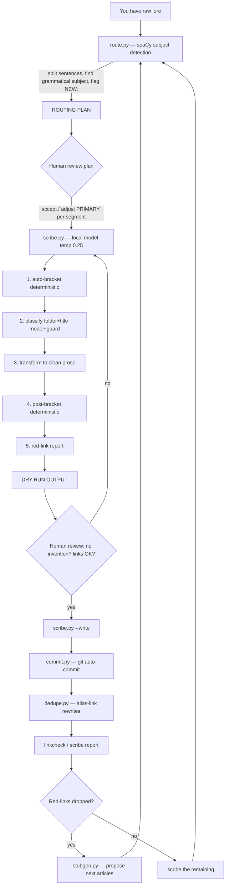

# Chronicler Pipeline — Local Worldbuilding Workflow

All steps run **locally** (W6600 / qwen2.5-7b via llama.cpp, or pure
deterministic Python). No cloud model touches lore prose — so no content-filter
refusals. Human review gates every write.

## Flowchart



## Submodules

| Script | Role | Deterministic? |
|--------|------|----------------|
| `route.py` | Split lore by sentence, find subject, route to PRIMARY article, flag NEW entities | Yes (spaCy dep-parse) |
| `scribe.py` | Transcribe raw lore → wiki page (auto-bracket, classify, transform, post-bracket, red-link report) | Hybrid (model @0.25 + deterministic guards) |
| `dedupe.py` | Rewrite links to alias form (display-text pipes) for one-click resolution | Yes |
| `drift.py` | Fact-drift check (input lore vs article) — no invention gate | Hybrid (entity diff + model @0.1) |
| `ground.py` | Generate grounding questions for thin lore (local model) | Model @0.25 |
| `commit.py` | Git auto-commit after each `--write` (reversible history) | Yes |
| `stubgen.py` | Propose missing articles from red-links | Model @0.25 |
| `linkcheck.py` | Count/report remaining red-links | Yes |

## Known gaps (not yet tool-covered)

| # | Gap | Status |
|---|-----|--------|
| 1 | Fact-drift check (output vs input lore) | DONE (drift.py) |
| 2 | Contradiction check (new vs existing vault) | TODO |
| 3 | New-article handoff: emit ready scribe commands from route.py NEW: flags | TODO |
| 4 | Cross-link propagation (segment into 2+ articles) | TODO |
| 5 | Batch runner (N segments at once) | TODO |
| 6 | Backup / versioning | DONE (commit.py) |
| 7 | Grounding-question generator | DONE (ground.py) |
| 8 | Autonomous trusted mode (--trust flag) | TODO |

## Rollback

Every `--write` is a git commit. To revert the last edit:
```bash
cd ~/Documents/Chronicler && git revert --no-edit HEAD
```
To see history: `git log --oneline`.
